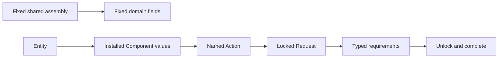

+++
title = "Architecture and lifecycle"
weight = 10
+++

v0's [`world` package](https://github.com/evefrontier/world-contracts/blob/6fd08169ba4c0e880e91548cd0314cbb91bc92ed/contracts/world/Move.toml) models concrete shared assemblies. An assembly owns fixed fields such as its deterministic tenant/item key, owner-cap ID, status, location, energy, and metadata; anchoring and sharing are direct lifecycle operations.

v1's active packages include [`core`](https://github.com/evefrontier/world-contracts/blob/acb0a16cd4b754bd9c41c058007932f131a7f258/contracts/core/Move.toml), `character`, `inventory`, `metadata`, `currency`, `creation`, `generic_module`, `killmail`, and `power`; the former `world` package is [archived](https://github.com/evefrontier/world-contracts/tree/acb0a16cd4b754bd9c41c058007932f131a7f258/contracts/archive/world). An [`Entity`](https://github.com/evefrontier/world-contracts/blob/acb0a16cd4b754bd9c41c058007932f131a7f258/contracts/core/sources/entity.move) is deterministically derived from a tenant-scoped key and holds dynamically installed typed [`Component<T>`](https://github.com/evefrontier/world-contracts/blob/acb0a16cd4b754bd9c41c058007932f131a7f258/contracts/core/sources/component.move) values. A numeric component ID is the storage key; an optional name is only a display label.

`install`, `uninstall`, action changes, and interaction lock an entity and return a no-ability [`Request`](https://github.com/evefrontier/world-contracts/blob/acb0a16cd4b754bd9c41c058007932f131a7f258/contracts/core/sources/request.move). Each [`Requirement`](https://github.com/evefrontier/world-contracts/blob/acb0a16cd4b754bd9c41c058007932f131a7f258/contracts/core/sources/requirement.move) must be consumed before completion. [`GenericModule`](https://github.com/evefrontier/world-contracts/blob/acb0a16cd4b754bd9c41c058007932f131a7f258/contracts/generic_module/sources/generic_module.move) can store opaque type ID and bytes for fittings without on-chain logic; this does not make their gameplay behaviors active.

The active Entity supports request-gated deletion; its [source](https://github.com/evefrontier/world-contracts/blob/acb0a16cd4b754bd9c41c058007932f131a7f258/contracts/core/sources/entity.move) now aborts while any component is still installed, so deletion no longer leaves orphaned dynamic fields. Modules carry local version checks, but the reviewed active source has no universal cross-package data migration function. Treat upgrades and deletion as explicit integration and lifecycle work, not automatic compatibility.

[Entity](https://github.com/evefrontier/world-contracts/blob/acb0a16cd4b754bd9c41c058007932f131a7f258/contracts/core/sources/entity.move) exposes read-only views of owner and admin actions. The creation [Layout](https://github.com/evefrontier/world-contracts/blob/acb0a16cd4b754bd9c41c058007932f131a7f258/contracts/creation/sources/layout.move) groups installed modules into sections and tracks the Shell in a command module. [PowerGrid](https://github.com/evefrontier/world-contracts/blob/acb0a16cd4b754bd9c41c058007932f131a7f258/contracts/power/sources/power_grid.move) models generators, loads, fuel bays, and per-type fuel pools; it trips on overload and requires a Shell to switch on. Its read-only snapshot includes module and generator state and each fuel pool’s projected burn rate.
